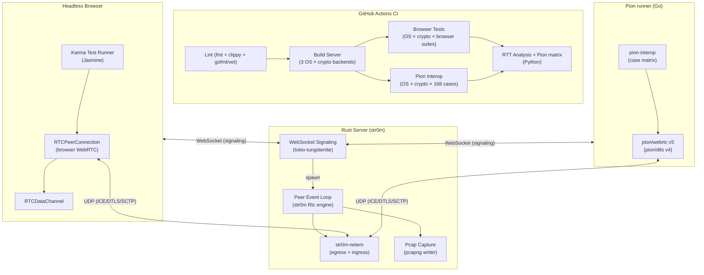
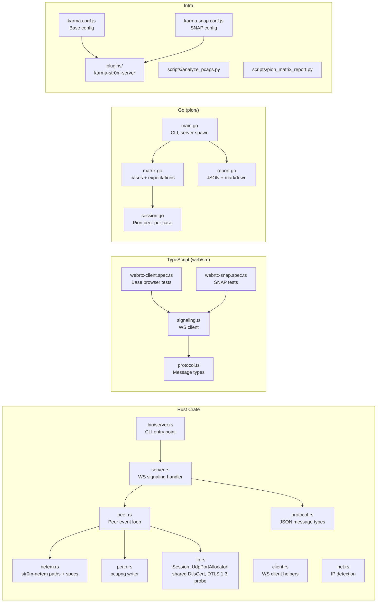
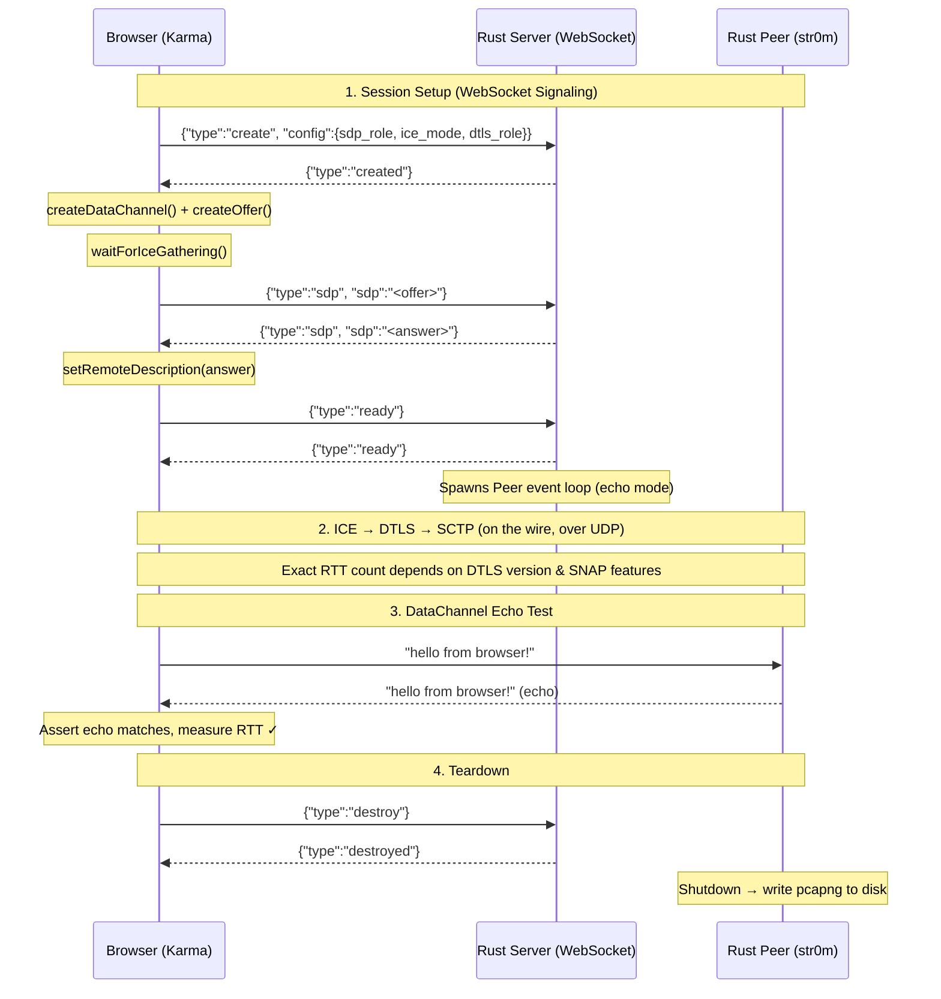
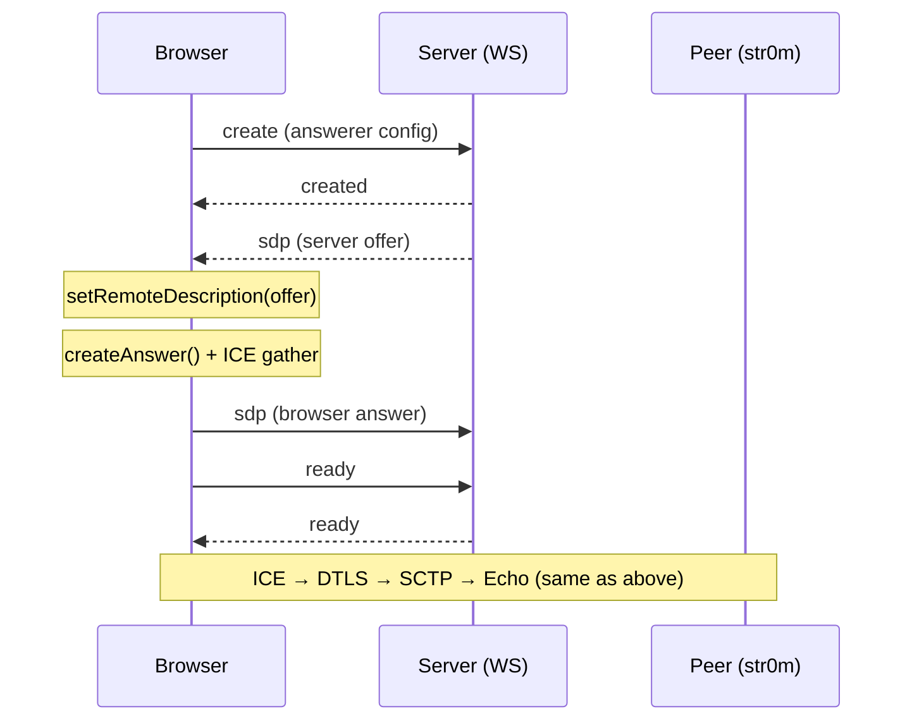
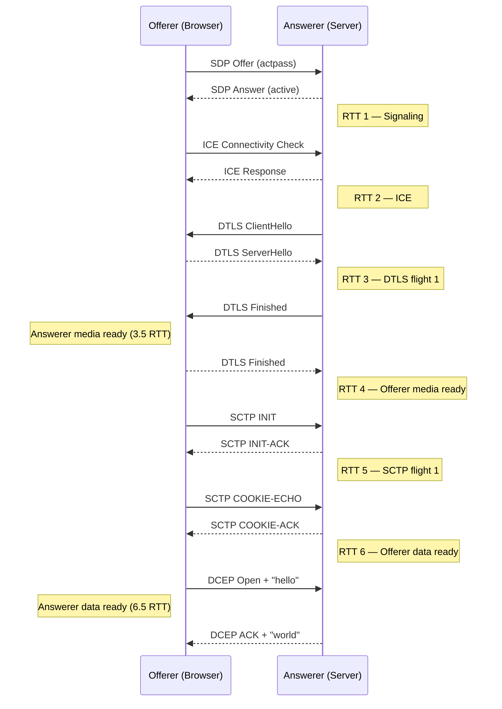
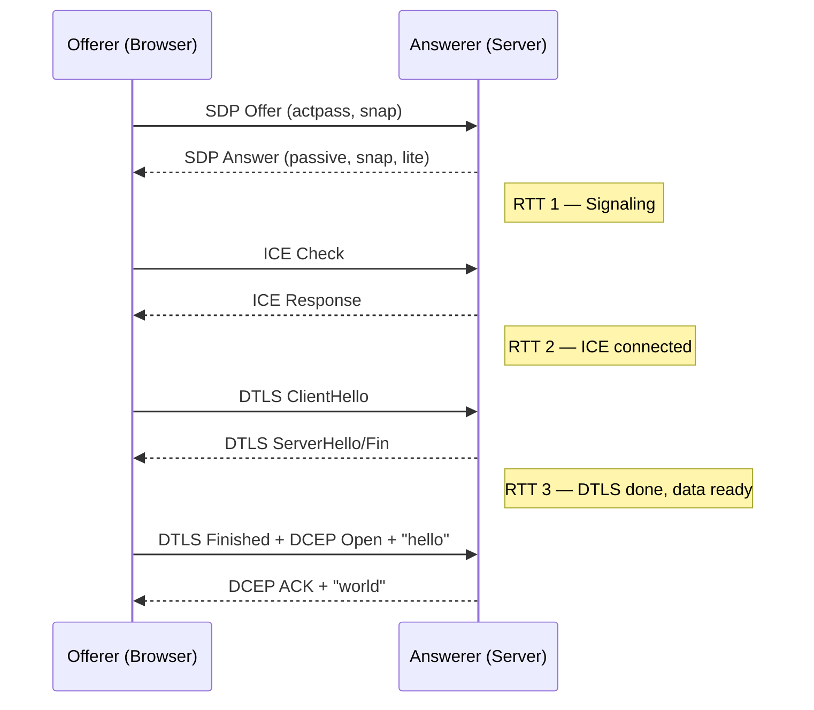
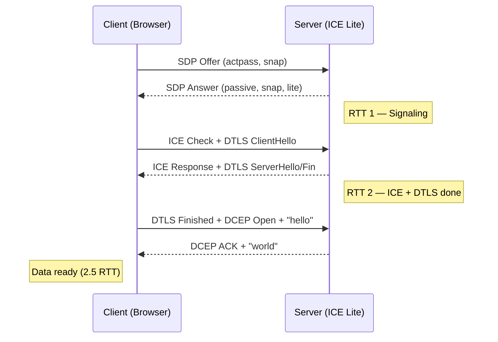
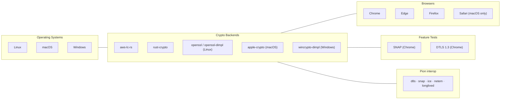
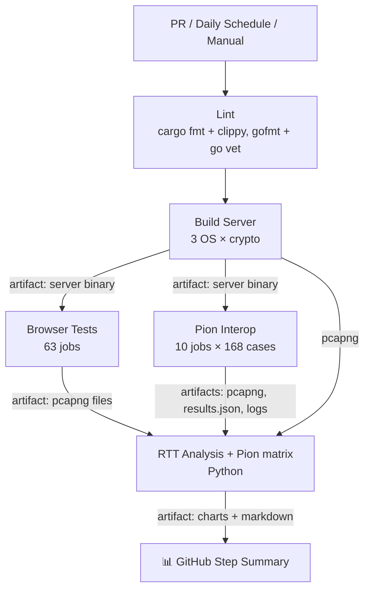

# str0m Browser Integration Tests

End-to-end WebRTC integration tests for [str0m](https://github.com/algesten/str0m), exercising **ICE**, **DTLS**, **SCTP**, and **DataChannel** negotiation between a Rust server and real browsers (Chrome, Edge, Firefox, Safari) and [Pion](https://github.com/pion/webrtc) (Go). All sessions are packet-captured and analyzed to count **round-trip times (RTTs)** — making this the primary observatory for measuring the connection-setup improvements delivered by **DTLS 1.3** and **SNAP**. The str0m side can emulate lossy and slow networks with [str0m-netem](#network-emulation-str0m-netem).

## The Problem: 6 RTTs to Open a Data Channel

The current WebRTC connection setup ([RFC 8829](https://datatracker.ietf.org/doc/rfc8829/)) incurs **4 RTTs** before media can be sent and **6 RTTs** before the data channel opens. Five separate protocols are stacked and serialized:

| # | Protocol | Purpose | Handshake | RTTs |
|:-:|----------|---------|-----------|:----:|
| 1 | **Signaling** (e.g. HTTP) | SDP offer/answer exchange | 1 flight | 1 |
| 2 | **ICE** ([RFC 8445](https://datatracker.ietf.org/doc/rfc8445/)) | Find a viable transport path | Connectivity checks | 1 |
| 3 | **DTLS 1.2** ([RFC 6347](https://datatracker.ietf.org/doc/rfc6347/)) | Secure the transport | 4-way handshake | 2 |
| 4 | **SCTP** ([RFC 4960](https://datatracker.ietf.org/doc/rfc4960/)) | Reliability layer over DTLS | 4-way handshake | 2 |
| 5 | **DCEP** ([RFC 8832](https://datatracker.ietf.org/doc/rfc8832/)) | Map data channels to SCTP streams | Piggybacks on data | 0 |
| | | | **Total** | **6** |

In 2011, this wasn't much worse than the 4 RTTs needed for a WebSocket over TCP/TLS. Today, compared to QUIC's ([RFC 9000](https://datatracker.ietf.org/doc/rfc9000/)) 0-RTT setup, it seems incredibly slow — especially as WebRTC shifts from peer-to-peer calls (where human answer latency masks setup time) to **client-server** use cases (conferencing, game streaming, AI services, robotics) where every RTT is directly observable.

## Optimizing WebRTC: From 6 RTTs to 2

WebRTC connection setup can be optimized using orthogonal, backwards-compatible improvements:

| Optimization | What it Does | RTT Savings |
|---|---|:---:|
| **SNAP** | SCTP was designed as L4 with anti-hijack/DDoS mechanisms (cookie exchange). Under DTLS these are redundant. SNAP removes the SCTP 4-way handshake entirely, exchanging init params declaratively via SDP. | **-2 RTT** |
| **DTLS 1.3** ([RFC 9147](https://datatracker.ietf.org/doc/rfc9147/)) | Reduces the DTLS handshake from 2 RTTs to 1 RTT. | **-1 RTT** |
| **Combined** | SNAP + DTLS 1.3 | **-3 RTT** |

This repo captures pcaps from every test permutation so we can **observe and quantify** these improvements as str0m and browsers add support.

> **Note:** DTLS 1.3 is enabled by default in Chrome/Edge since Oct 2025. The server's `server_dtls_version: "auto"` (the default) maps to str0m's `DtlsVersion::Auto`, so browsers negotiate DTLS 1.3 on every backend that supports it (all dimpl based ones: `aws-lc-rs`, `rust-crypto`, `apple-crypto`, `openssl-dimpl`, `wincrypto-dimpl`); the plain `openssl` backend is DTLS 1.2 only and `auto` falls back to 1.2 there. SNAP is verified in browser, Pion and native Rust-to-Rust tests. Safari is tested natively on macOS via `safaridriver`, though explicit DTLS 1.3 and SNAP tests are currently skipped as Safari does not yet fully support these natively.

> **Dependencies:** `str0m` and `str0m-netem` track the upstream [str0m `main` branch](https://github.com/algesten/str0m/tree/main). `Cargo.lock` isn't committed, so every build picks up the latest `main`.

## Architecture Overview



## Component Model



## This Repo's Signaling & Test Flow

The test harness uses a simple JSON-over-WebSocket signaling protocol. Below shows the **browser-as-offerer** flow (the most common browser configuration):



### Browser-as-Answerer Flow

When `client_sdp_role = "answerer"`, the server creates the offer:



## Optimized Protocol Ladder Diagrams

The following diagrams show the connection flow improvements.

### Current WebRTC Setup (6 RTTs to Data Channel)



### DTLS 1.3 + SNAP Setup (2 RTTs to Data Channel)

With **SNAP** (SCTP params in SDP) and **DTLS 1.3** (1-RTT handshake):



### DTLS 1.3 + SNAP (Minimal RTTs)

With DTLS 1.3 reducing the handshake to 1 RTT and SNAP eliminating the SCTP 4-way:



### RTT Summary

```mermaid
gantt
    title WebRTC Connection Setup RTTs (Offerer → Data Ready)
    dateFormat X
    axisFormat %s

    section Standard (DTLS 1.2)
    Signaling       :a0, 0, 1
    ICE (STUN)      :a1, after a0, 1
    DTLS 1.2        :a2, after a1, 2
    SCTP 4-way      :a3, after a2, 2
    Data Ready      :milestone, after a3, 0

    section DTLS 1.3 only
    Signaling       :b0, 0, 1
    ICE (STUN)      :b1, after b0, 1
    DTLS 1.3        :b2, after b1, 1
    SCTP 4-way      :b3, after b2, 2
    Data Ready      :milestone, after b3, 0

    section SNAP + DTLS 1.3
    Signaling       :c0, 0, 1
    ICE + DTLS 1.3  :c1, after c0, 1
    Data Ready      :milestone, after c1, 0

    section SNAP+DTLS1.3
    Signaling       :d0, 0, 1
    ICE+DTLS 1.3    :d1, after d0, 1
    Data Ready      :milestone, after d1, 0

    section Future 0-RTT
    Signaling       :e0, 0, 1
    Data Ready      :milestone, after e0, 0
```



## Test Matrix

### Base Tests

Every base test verifies a full WebRTC connection by sending `"hello from browser!"` through a DataChannel and confirming the server echoes it back.

| Test Case | SDP Role | DTLS Role | ICE Mode |
|-----------|----------|-----------|----------|
| `offerer_active_lite` | Browser offers | Browser = DTLS client | Server ICE-Lite |
| `offerer_active_full` | Browser offers | Browser = DTLS client | Server ICE-Full |
| `offerer_passive_lite` | Browser offers | Browser = DTLS server | Server ICE-Lite |
| `offerer_passive_full` | Browser offers | Browser = DTLS server | Server ICE-Full |
| `answerer_active_lite` | Server offers | Browser = DTLS client | Server ICE-Lite |
| `answerer_active_full` | Server offers | Browser = DTLS client | Server ICE-Full |

### Feature Tests (SNAP / DTLS 1.3)

Experimental Chromium field trials are enabled via browser flags:

| Feature | Chromium Flag | What it Does | Spec |
|---------|---------------|--------------|------|
| **SNAP** | `WebRTC-Sctp-Snap/Enabled/` | Removes SCTP 4-way handshake; init params exchanged in SDP | [draft-hancke-tsvwg-snap](https://datatracker.ietf.org/doc/draft-hancke-tsvwg-snap/) |
| **Combined** | SNAP + DTLS 1.3 | SNAP + DTLS 1.3 = minimal RTT setup | N/A |

Each feature test runs `offerer` and `answerer` variants against ICE-Lite.

> **ICE Lite is RECOMMENDED for optimized servers** (for minimal RTTs): a Lite server can respond immediately without waiting for its own connectivity check, enabling minimal RTTs.

### Pion Interop Matrix

[`pion/`](pion/) is a Go runner built on [pion/webrtc](https://github.com/pion/webrtc) **v5** (its `next` branch), which uses [pion/dtls](https://github.com/pion/dtls) **v4** with DTLS 1.3, and Pion's SNAP support (`SettingEngine.EnableSctpSnap`). It plays the browser's part against the same str0m server: it speaks the WebSocket signaling protocol, opens a data channel, checks the echo and then verifies what was negotiated on **both** sides. Pion reports its DTLS version from its transport stats, str0m returns its own in the `destroyed` report, and SNAP is checked via `a=sctp-init` in both SDPs.

| Suite | Cases | What varies |
|-------|:-----:|-------------|
| `dtls` | 36 | str0m `server_dtls_version` {1.2, auto, 1.3} × Pion min/max {1.2, auto, 1.3} × Pion offerer/answerer × Pion DTLS client/server (= str0m DTLS server/client). Pairs without a common version must be **rejected** (🚫). |
| `snap` | 20 | SNAP on both sides for every DTLS version, plus fallback when only str0m or only Pion advertises `a=sctp-init` |
| `ice` | 12 | str0m ICE full instead of lite |
| `netem` | 96 | str0m-netem profiles `loss5`, `loss15`, `burst`, `delay` × DTLS versions × SNAP on/off × both role pairs |
| `longlived` | 4 | Idle 45 s before a second echo (past the 40 s DTLS handshake deadline), str0m as DTLS client and server |

Expected outcomes are computed per case, for example `auto` vs `1.2` must negotiate 1.2, `auto` vs `auto` 1.3. When the server's crypto backend has no DTLS 1.3 (plain `openssl`), `auto` means 1.2 there and the str0m 1.3 cases are skipped. Failures that match a **known upstream issue** are reported as ⚠️ (`xfail`) and don't fail the run:

| Known issue | Effect |
|-------------|--------|
| `str0m-openssl-no-dtls-retransmit` | str0m's plain `openssl` backend never retransmits DTLS handshake flights (its `handle_timeout` doesn't drive OpenSSL's DTLS timer), so with netem loss a single lost handshake packet stalls the connection. The dimpl backends recover. |

> **Reading the timings:** DTLS 1.3 only lets the DTLS *client* finish earlier (1 RTT instead of 2). The server finishes at 1.5 RTT with either version, so the gain only shows when the side that sends first after the handshake is the DTLS client (with SNAP that's whoever created the data channel). str0m (dimpl) as 1.3 client sends right after its Finished, as RFC 8446 §4.4.4 allows. Pion as 1.3 client doesn't: pion/dtls v4 only completes the client handshake (and holds back application writes) until the server ACKs the client's Finished, and pion/webrtc only starts SCTP after that, so Pion as DTLS client is ready at 2 RTT just like with DTLS 1.2. Neither pion/dtls nor pion/webrtc has an option for this (checked `v4.0.0-rc.3` and `main` as of 2026-10-18). Patching pion/dtls locally to send right after Finished, while still retransmitting Finished until it's ACKed, saved one RTT (~150 ms on the `delay` profile) and still passed every loss case.

```bash
cargo build --release --bin server
go -C pion run . -server-bin ../target/release/server       # all suites
go -C pion run . -server-bin ../target/release/server -suites dtls,snap -run 'offerer_passive'
go -C pion run . -list                                        # print case names
```

Without `-server-bin` the runner uses `$PREBUILT_SERVER_BINARY` or builds the server with cargo (`npm run test:pion` does exactly that). Results go to `target/pion-interop/`: `results.json`, `summary.md` (tables like the ones in the CI step summary), `server.log` and per-case Pion logs for failures (`-keep-logs` keeps them all). Pcaps are written to `target/pcap/` as `pion_<suite>_<pion sdp>_<pion dtls role>_<ice>_s<str0m dtls>_p<pion dtls>_snap<mode>[_<netem>]_server.pcapng`. Useful flags: `-parallel`, `-netem-profiles`, `-hold`, `-pion-log`, `-server-args "--netem loss=2"` and `-summary-md`. To try a newer Pion, run `go get github.com/pion/webrtc/v5@next` in `pion/`.

## Network emulation (str0m-netem)

The str0m peer can run [str0m-netem](https://github.com/algesten/str0m/tree/main/crates/netem) (sans-IO loss, latency, jitter, duplication, reordering and rate limiting) on both its **egress** (str0m → remote) and **ingress** (remote → str0m) path, independently. Netem is seeded from the session id unless a seed is given, so a test case sees the same loss pattern on every run. Pcaps show str0m's view of the network: egress packets before netem drops or delays them, ingress packets after netem. The `destroyed` message carries a report with per-direction netem counters (`packets`, `dropped`, `duplicated`) plus the negotiated DTLS version and setup timings.

Per session, in the `create` message:

```json
{"type": "create", "session_id": "lossy", "config": {
  "client_sdp_role": "offerer", "server_ice_mode": "lite", "client_dtls_role": "active",
  "server_netem": {
    "egress":  {"loss_percent": 5, "latency_ms": 40, "jitter_ms": 5},
    "ingress": {"preset": "cellular", "seed": 7}
  }
}}
```

Link fields: `preset` (`wifi`, `wifi_lossy`, `wifi_congested`, `cellular`, `satellite`, `congested`), `loss_percent`, `loss_correlation`, `burst_interval`/`burst_length` (Gilbert-Elliot bursts, in packets), `latency_ms`, `jitter_ms`, `duplicate_percent`, `reorder_gap`, `rate_kbps`/`buffer_bytes`, `seed`.

As a server default for every session that doesn't send its own (handy for browser runs):

```bash
target/release/server --netem loss=5                       # both directions
target/release/server --netem-egress cellular --netem-ingress "burst=20:3,latency=40ms"
STR0M_NETEM="loss=5" npm run test:chrome                   # karma passes STR0M_NETEM[_EGRESS|_INGRESS]
```

Spec keys: a preset name, `loss` (%), `corr`, `burst=<interval>:<length>`, `latency`/`jitter` (ms), `dup` (%), `reorder`, `rate` (kbps), `buffer` (bytes), `seed`.

### CI Matrix



The full CI runs **~63 browser test jobs** (after exclusions for platform-specific crypto backends and browser compatibility) plus **10 Pion interop jobs** (one per OS × crypto backend, 168 cases each).

## Project Structure

```
├── .github/workflows/
│   ├── browser-tests.yml          # CI: lint → build → browser tests + Pion interop → analyze
│   └── nightly.yml                # Daily schedule, runs browser-tests.yml
├── pion/                          # Pion (Go) interop runner, see "Pion Interop Matrix"
│   ├── main.go                    # CLI, spawns the server, runs cases in parallel
│   ├── matrix.go                  # Suites, cases, expected outcomes
│   ├── session.go                 # One Pion peer per case + known upstream issues
│   ├── report.go                  # results.json + markdown report
│   ├── server.go / protocol.go    # Server process + signaling types
│   └── go.mod                     # pion/webrtc v5 (next), pion/dtls v4
├── scripts/
│   ├── analyze_pcaps.py           # Post-test RTT analysis & charts
│   └── pion_matrix_report.py      # Merges Pion results of all CI jobs
├── src/
│   ├── bin/server.rs              # CLI entry point (clap)
│   ├── lib.rs                     # Session state, DtlsCert cache, port allocator, DTLS 1.3 probe
│   ├── server.rs                  # WebSocket signaling handler
│   ├── client.rs                  # WS client helpers (used by Rust tests)
│   ├── peer.rs                    # str0m Rtc event loop + netem + pcap capture
│   ├── netem.rs                   # str0m-netem integration and spec parsing
│   ├── protocol.rs                # JSON signaling message types
│   ├── pcap.rs                    # pcapng file writer
│   └── net.rs                     # Network interface / IP detection
├── tests/
│   └── integration.rs             # Native Rust-to-Rust integration tests
├── web/
│   ├── karma.conf.js              # Karma config (base browser tests)
│   ├── karma.snap.conf.js         # Karma config (SNAP tests)
│   ├── plugins/                   # karma-str0m-server, karma-edge-launcher
│   └── src/
│       ├── protocol.ts            # TS mirror of protocol.rs
│       ├── signaling.ts           # WS client for browsers
│       ├── webrtc-client.spec.ts  # Base test suite (10 test cases)
│       └── webrtc-snap.spec.ts    # SNAP test suite (2 test cases)
├── target/pcap/                   # Captured pcapng files (gitignored)
├── target/pion-interop/           # Pion runner results and logs (gitignored)
├── Cargo.toml                     # Rust deps (str0m + str0m-netem from git)
└── package.json                   # Root npm scripts (delegates to web/, test:pion)
```

## CI Pipeline



`browser-tests.yml` runs on every pull request and on manual dispatch. The daily run is a separate `nightly.yml` workflow that calls it. GitHub disables scheduled workflows after 60 days without repository activity, and keeping the schedule out of `browser-tests.yml` means that can't stop PR runs.

Each browser test job:
1. Downloads the pre-built server binary
2. Installs npm dependencies in `web/`
3. Karma launches the server via the `karma-str0m-server` plugin
4. Spawns the headless browser
5. Runs the Jasmine test suites
6. Uploads pcapng captures as artifacts

Each Pion job downloads the same server binary, builds `pion/` with Go, runs all suites (`-parallel 4`), writes its report to the step summary and uploads pcaps (`pcaps-<os>-<crypto>-test-pion`) and results (`pion-results-<os>-<crypto>`). The analyze job merges all `results.json` files into one case × platform matrix (`pion-matrix.md` in the `rtt-analysis` artifact) and lists every case that failed on any platform in the step summary.

## Running Locally

### Prerequisites

- **Rust** (stable, edition 2024)
- **Node.js** 20+
- **Chrome**, **Edge**, or **Firefox** installed
- **Go** 1.24+ for the Pion interop runner

### Build & Run

```bash
# Build the server
cargo build --release --bin server

# Run native Rust-to-Rust tests
cargo test --release

# Run browser tests (Chrome)
cd web && npm ci
npm run test:chrome

# Run SNAP feature tests
npm run test:snap:chrome

# Run the Pion interop matrix (from the repo root)
go -C pion run . -server-bin ../target/release/server

# Analyze captured pcaps
pip install matplotlib numpy
python scripts/analyze_pcaps.py target/pcap/ --output-dir analysis
```

`RUST_LOG` controls the server's and tests' logging (default `info`), e.g. `RUST_LOG=info,str0m=debug,dimpl=trace`.

> On macOS, the application firewall can silently drop inbound UDP to a freshly built `target/release/server` on the LAN address the browser tests use (loopback is unaffected, so Pion and native tests still pass). Allow the binary in *System Settings → Network → Firewall* or let Karma build and use `target/debug/server`.

### Crypto Backend Selection

```bash
# Default (aws-lc-rs)
cargo build --release

# Explicit selection
cargo build --release --no-default-features --features rust-crypto
cargo build --release --no-default-features --features openssl       # Linux
cargo build --release --no-default-features --features apple-crypto  # macOS
cargo build --release --no-default-features --features wincrypto     # Windows
```

## Pcap Analysis

Every test captures a pcapng file at `target/pcap/{session_id}_{role}.pcapng`. The analysis script:

1. Parses each pcapng file (custom minimal parser matching our writer format)
2. Classifies packets: `STUN-REQ`, `STUN-RESP`, `DTLS-HS`, `DTLS-APP`, etc.
3. Counts RTTs per phase (STUN, DTLS handshake, SCTP handshake)
4. Generates a markdown summary table and PNG bar charts
5. Outputs to `$GITHUB_STEP_SUMMARY` for in-PR visibility

Pion sessions show up with browser `pion`; their `Client DTLS cfg` column is Pion's DTLS version setting and `Netem` is the str0m-netem profile (both `-` for browser and native sessions). Under netem loss the RTT counts include retransmitted flights.

### Reading the RTT Table

| Session | Browser | Crypto | STUN RTTs | DTLS RTTs | SCTP RTTs | Total |
|---------|---------|--------|:---------:|:---------:|:---------:|:-----:|
| `chrome_offerer_active_lite` | Chrome | aws-lc-rs | 1 | 1 | 2 | **4** |
| `chrome_dtls13_snap_offerer` | Chrome | aws-lc-rs | 1 | 0 | 0 | **1** |

Expected progression as str0m adds support:

| Milestone | Total RTTs | Breakdown | Notes |
|-----------|:----------:|-----------|-------|
| Baseline (DTLS 1.2) | **6** | 1 sig + 1–1.5 ICE + 2 DTLS + 2 SCTP | Full ICE with non-aggressive nomination |
| DTLS 1.3 | **5** | 1 sig + 1–1.5 ICE + 1 DTLS + 2 SCTP | Chrome/Edge default since Oct 2025 |
| + SNAP | **3** | 1 sig + 1 ICE + 1 DTLS | SNAP removes SCTP handshake entirely |
| **Full DTLS 1.3 + SNAP** | **2** | 1 sig + 1 ICE/DTLS | SNAP + DTLS 1.3 |

> With **ICE Lite** (recommended for minimal RTTs), the server is ready to send at **1.5 RTT** — it doesn't need to wait for its own triggered check.

## References

- **SNAP** — [draft-hancke-tsvwg-snap](https://datatracker.ietf.org/doc/draft-hancke-tsvwg-snap/) — SCTP Negotiation Acceleration Protocol
- **DTLS 1.3** — [RFC 9147](https://datatracker.ietf.org/doc/rfc9147/)
- **str0m** — [github.com/algesten/str0m](https://github.com/algesten/str0m)
- **WebRTC Data Channels** — [RFC 8831](https://datatracker.ietf.org/doc/rfc8831/) (the protocol sandwich, Section 5)
- **DCEP** — [RFC 8832](https://datatracker.ietf.org/doc/rfc8832/) — DataChannel Establishment Protocol

## License

See [str0m](https://github.com/algesten/str0m) for the upstream library license.